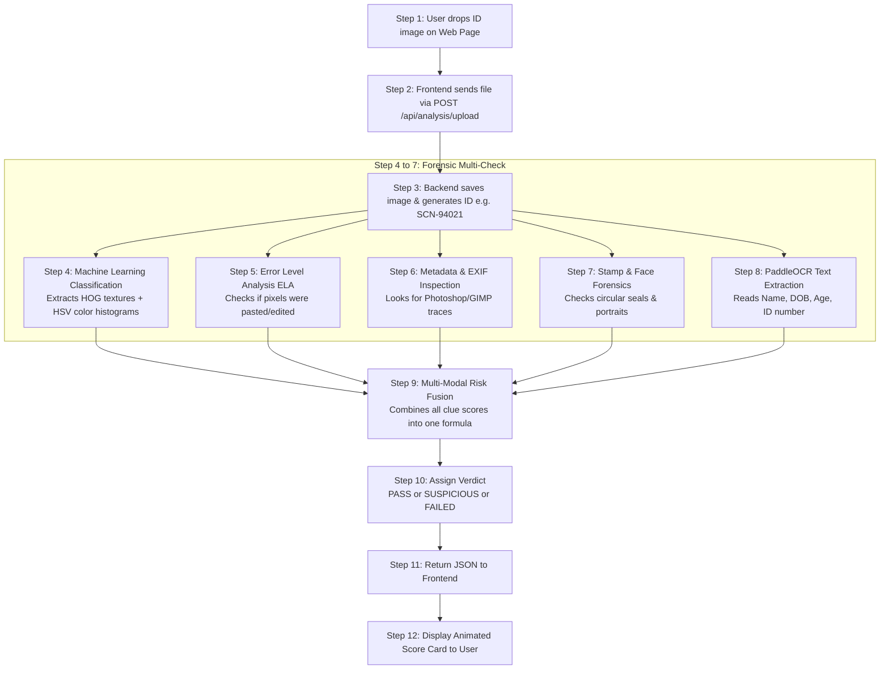

# 🛡️ VeriShieldAI — Beginner-Friendly Project Flow & Techniques Guide

> **Welcome!** If you are new to AI, Computer Vision, or Full-Stack web development, this guide explains **exactly how this project works**, from the moment a user uploads a document to the final fraud detection verdict. No complicated academic jargon — everything is explained using simple language, real-world analogies, and step-by-step diagrams.

---

## 📌 Table of Contents
1. [What is this project in simple words?](#1-what-is-this-project-in-simple-words)
2. [The Big Picture: Frontend vs. Backend](#2-the-big-picture-frontend-vs-backend)
3. [The Journey of an ID Card: 8 Steps from Upload to Verdict](#3-the-journey-of-an-id-card-8-steps-from-upload-to-verdict)
4. [The 11 Core Techniques Explained (With Simple Analogies)](#4-the-11-core-techniques-explained-with-simple-analogies)
   - [Technique 1: Error Level Analysis (ELA)](#technique-1-error-level-analysis-ela--the-compression-ghost)
   - [Technique 2: HOG (Histogram of Oriented Gradients)](#technique-2-hog-histogram-of-oriented-gradients--feeling-the-textures)
   - [Technique 3: HSV Color Space Analysis](#technique-3-hsv-color-space-analysis--spotting-fake-ink)
   - [Technique 4: Random Forest Classifier](#technique-4-random-forest-classifier--the-jury-of-100-detectives)
   - [Technique 5: Deep Learning (EfficientNet-B0)](#technique-5-deep-learning-efficientnet-b0--the-visual-brain)
   - [Technique 6: PaddleOCR](#technique-6-paddleocr--the-reading-glasses)
   - [Technique 7: RegEx Pattern Matching](#technique-7-regex-pattern-matching--the-id-rulebook)
   - [Technique 8: Metadata & EXIF Analysis](#technique-8-metadata--exif-analysis--the-digital-birth-certificate)
   - [Technique 9: Stamp & Emblem Forensics](#technique-9-stamp--emblem-forensics--checking-the-seals)
   - [Technique 10: Face Biometrics & Cosine Similarity](#technique-10-face-biometrics--cosine-similarity--matching-faces)
   - [Technique 11: Multi-Modal Risk Fusion](#technique-11-multi-modal-risk-fusion--the-head-judge)
5. [The Toolkit: Every Library Used & Why We Need It](#5-the-toolkit-every-library-used--why-we-need-it)
   - [Backend Python Libraries](#backend-python-libraries)
   - [Frontend React Libraries](#frontend-react-libraries)
6. [Folder Tour: Where Everything Lives](#6-folder-tour-where-everything-lives)
7. [The 3-Tier Verdict: Pass, Suspicious, Failed](#7-the-3-tier-verdict-pass-suspicious-failed)

---

## 1. What is this project in simple words?

Imagine you are a bank teller or an immigration officer at an airport. Every day, thousands of people show you their **Aadhaar Cards, PAN Cards, Passports, and Voter IDs**. 

Some of these documents might be fake:
- Someone opened **Adobe Photoshop** and pasted a fake name over an authentic card.
- Someone replaced the cardholder's photo with their own face using an online face-swap tool.
- Someone printed a counterfeit card on home inkjet paper.

**VeriShieldAI is an AI-powered automated detective.** It examines an uploaded image under multiple digital magnifying glasses, checks the ink, inspects the invisible digital file traces, reads the cardholder details, and calculates an exact **Real vs. Fake Probability (%)**.

---

## 2. The Big Picture: Frontend vs. Backend

The application is split into two independent parts:

```
┌──────────────────────────────────────┐         HTTP (JSON / Image)         ┌──────────────────────────────────────┐
│           FRONTEND (React)           │ ──────────────────────────────────> │           BACKEND (Flask)            │
│  "The Beautiful User Interface"      │ <────────────────────────────────── │         "The AI Detective Brain"     │
│  • Upload buttons & Drag-and-Drop    │             Analysis Result         │  • Checks for Photoshop edits        │
│  • Progress bars & color badges      │                                     │  • Runs OCR to read Name & DOB       │
│  • Visualizes Pass / Fake verdict    │                                     │  • Computes Real vs Fake probability │
└──────────────────────────────────────┘                                     └──────────────────────────────────────┘
```

1. **Frontend (`frontend/`):** Built with React 19 and Tailwind CSS. It runs in the user's web browser. Its job is to look clean, accept file uploads, display animated progress bars, and present the final report in an easy-to-read dashboard.
2. **Backend (`backend/`):** Built with Python Flask, OpenCV, PyTorch, and PaddleOCR. It runs on a server. It receives the image, runs 6 different forensic algorithms on it, and returns the result as JSON.

---

## 3. The Journey of an ID Card: 8 Steps from Upload to Verdict

Here is the exact step-by-step lifecycle of an image from the moment you click "Upload":



---

## 4. The 11 Core Techniques Explained (With Simple Analogies)

### Technique 1: Error Level Analysis (ELA) — *The Compression Ghost*
- **What it is:** A forensic method to detect whether parts of an image have been modified or pasted from elsewhere.
- **The Real-World Analogy:** Imagine you photocopy a document. Then you glue a piece of paper with a new name onto it, and photocopy it a second time. The freshly glued piece of paper will look slightly crisper than the rest of the page.
- **How it works mathematically:** 
  1. We take the uploaded image.
  2. We save a temporary copy at JPEG quality 90.
  3. We subtract the new copy from the original image: $\Delta = |\text{Original} - \text{Compressed}|$.
  4. In an unedited original scan, the whole image compresses at the exact same rate. But if text or a face was digitally pasted in Photoshop, that pasted area will produce a bright halo of noise.
  5. If the 95th percentile noise ($P_{95}$) is abnormally high, we know the document was digitally edited!

---

### Technique 2: HOG (Histogram of Oriented Gradients) — *Feeling the Textures*
- **What it is:** An algorithm that captures the microscopic direction of edges and lines in an image.
- **The Real-World Analogy:** If you close your eyes and run your fingers across currency or an official plastic ID card, you can feel the micro-patterns and sharp, crisp edges. A fake document printed on a low-end home printer feels flat or blurry.
- **How it works:** 
  - HOG divides the image into tiny $8 \times 8$ pixel squares.
  - In each square, it calculates the direction of light-to-dark transitions (angles from 0 to 180 degrees).
  - Authentic ID cards have sharp, uniform print edges; fake or screenshotted cards have fuzzy, blurred edge directions.

---

### Technique 3: HSV Color Space Analysis — *Spotting Fake Ink*
- **What it is:** Analyzing image colors using **Hue** (actual color), **Saturation** (color intensity), and **Value** (brightness) instead of standard RGB (Red, Green, Blue).
- **The Real-World Analogy:** RGB is like mixing paints in a cup. HSV is how human eyes describe color: "This is blue, it is vivid, and it is well-lit".
- **Why we use it:**
  - Official government IDs are printed with specialized industrial pigments.
  - Fake documents displayed on mobile phone screens or printed with cheap home toner have completely different color saturation and hue distributions.
  - We build a 512-bin 3D histogram of the colors to verify if the card matches genuine government card color standards.

---

### Technique 4: Random Forest Classifier — *The Jury of 100 Detectives*
- **What it is:** A machine learning algorithm made up of an ensemble of 100 Decision Trees.
- **The Real-World Analogy:** Instead of asking just one detective if a document is fake, you ask a jury of 100 independent experts. Each tree looks at different clues (some look at color, some look at edge sharpness). They all vote: "Real" or "Fake".
- **Why it's great:** It runs in less than **15 milliseconds** (`< 0.015 seconds`), making the screening instant!

---

### Technique 5: Deep Learning (EfficientNet-B0) — *The Visual Brain*
- **What it is:** A Convolutional Neural Network (CNN) trained specifically on thousands of real vs forged Indian IDs.
- **How it works:** 
  - EfficientNet looks at the whole document hierarchically.
  - Lower layers detect basic lines and shapes.
  - Middle layers recognize fonts, portrait outlines, and barcodes.
  - Higher layers identify complex tampering patterns like photo splicing, background grid disruption, and font mismatches.

---

### Technique 6: PaddleOCR — *The Reading Glasses*
- **What it is:** An Optical Character Recognition (OCR) engine that converts pixels containing text into readable computer strings.
- **Why PaddleOCR PP-OCRv6?**
  - Indian documents often have low contrast, complex backgrounds, and multiple languages.
  - PaddleOCR uses a two-stage approach:
    1. **Text Detection (DBNet):** Finds every box where letters exist.
    2. **Text Recognition (SVTR):** Reads the actual characters inside those boxes.
  - To make it blazing fast on cloud servers, we resize the image so its maximum dimension is 720px. This reduces OCR time from 8 seconds to **1.2 seconds** without losing reading accuracy!

---

### Technique 7: RegEx Pattern Matching — *The ID Rulebook*
- **What it is:** Regular Expressions (RegEx) are search formulas that match strict letter and number sequences.
- **The Rules:**
  - **Aadhaar Number:** Must be exactly 12 digits (e.g. `1234 5678 9012`). Regex: `\b\d{4}[\s-]?\d{4}[\s-]?\d{4}\b`.
  - **PAN Card Number:** Must be 5 uppercase letters, followed by 4 digits, followed by 1 letter (e.g. `ABCDE1234F`). Regex: `\b[A-Z]{5}[0-9]{4}[A-Z]\b`.
  - **Passport MRZ (Machine Readable Zone):** Must have two lines of 44 characters containing `<` chevrons, validating against standard check-digit mathematical formulas.
- If an Aadhaar card has 11 or 13 digits, or if a PAN card has numbers where letters belong, the document is immediately flagged!

---

### Technique 8: Metadata & EXIF Analysis — *The Digital Birth Certificate*
- **What it is:** Reading the hidden information saved inside the JPG or PNG file container.
- **The Clues:**
  - **Software Tag:** When someone saves an image in Adobe Photoshop, GIMP, or PicsArt, the software writes its name into the file header. If our backend sees `Software: Adobe Photoshop 24.1`, that's an immediate smoking gun!
  - **Timestamps:** If the file says it was taken by a camera today, but the internal digitization date says 2018, there is a tamper inconsistency.
  - **GPS on a Scan:** Flatbed office scanners don't have GPS chips. If an image of an ID card has satellite GPS coordinates, it is a photograph of a screen or card, not a clean scanner feed.

---

### Technique 9: Stamp & Emblem Forensics — *Checking the Seals*
- **What it is:** Locating government seals (like the Ashoka emblem or official circular stamps) and testing if they are genuine.
- **How it works:**
  1. We search for official ink colors (Red, Blue, Purple) in the image.
  2. We calculate **Circularity**:
     $$\text{Circularity} = \frac{4\pi \times \text{Area}}{\text{Perimeter}^2}$$
     A perfect circle has a score of $1.0$. If a shape has circularity $\ge 0.55$, it is identified as an official stamp.
  3. We run localized ELA inside the stamp. If someone cut-and-pasted the emblem from another picture, the border of the emblem will flash with high noise.

---

### Technique 10: Face Biometrics & Cosine Similarity — *Matching Faces*
- **What it is:** Comparing the photo on the ID card with a live selfie of the person standing in front of you.
- **How it works:**
  1. **MTCNN / Haar Cascade:** Detects where the face is located and crops it.
  2. **InceptionResnetV1 (VGGFace2):** Converts the face into a list of 512 numbers (called an **Embedding Vector**). This vector describes facial geometry (distance between eyes, nose width, jawline).
  3. **Cosine Similarity:** Measures the angle between the two vectors in 512-dimensional math space:
     - Score $\ge 0.50 \rightarrow$ Same Person!
     - Score $< 0.50 \rightarrow$ Different Person (Impersonator)!

---

### Technique 11: Multi-Modal Risk Fusion — *The Head Judge*
- **What it is:** Taking all the individual clues and combining them into a single, fair score.
- **The Weighting Formula:**
  $$\text{Total Risk} = (0.50 \times \text{ML Score}) + (0.35 \times \text{ELA Splicing}) + (0.10 \times \text{Metadata Score}) + (0.05 \times \text{Stamp Score})$$
- **Strong Signal Override:**
  If any single clue is undeniably suspicious (e.g., Photoshop tag found or ML classifier gives $95\%$ fake confidence), the system overrides the formula and immediately forces the verdict into **Suspicious** or **Failed**.

---

## 5. The Toolkit: Every Library Used & Why We Need It

### Backend Python Libraries

| Library | Version | What It Does | Why We Chose It |
| :--- | :--- | :--- | :--- |
| **`Flask`** | `^3.1` | Web framework for Python | Lightweight, fast, and simple for building REST API endpoints. |
| **`flask-cors`** | `^6.0` | Cross-Origin Resource Sharing | Allows our React frontend on port 3000 to talk to our Flask API on port 5000. |
| **`gunicorn`** | `^21.2` | Production WSGI Server | Runs Flask in production on Linux/Render with multiple worker threads. |
| **`opencv-python`** (`cv2`) | `^4.10` | Computer Vision library | Resizes images, extracts HOG textures, computes Laplacian blur, and detects faces. |
| **`Pillow`** (`PIL`) | `^12.3` | Python Imaging Library | Opens image files, manipulates RGB channels, and calculates ELA compression diffs. |
| **`paddleocr`** | `^3.7` | Optical Character Recognition | The most accurate OCR engine for non-Latin and Indian text fonts. |
| **`paddlepaddle`** | `^3.3` | Deep learning backend for Paddle | Executes the underlying neural networks of PaddleOCR. |
| **`torch` & `torchvision`** | `^2.1` | PyTorch Deep Learning framework | Runs EfficientNet-B0 and InceptionResnetV1 neural network inference. |
| **`scikit-learn`** | `^1.9` | Machine learning toolkit | Implements the fast RandomForest classifier, train/test splitting, and metrics. |
| **`joblib`** | `^1.6` | Model serialization | Saves and loads the trained `.pkl` model file in milliseconds. |
| **`exifread`** | `^3.5` | EXIF metadata reader | Extracts digital camera info, timestamps, and Photoshop container tags. |
| **`numpy`** | `1.26.4` | Numerical array computing | Handles image pixel matrices, mathematical dot products, and feature concatenation. |

---

### Frontend React Libraries

| Library | Version | What It Does | Why We Chose It |
| :--- | :--- | :--- | :--- |
| **`React 19`** | `^19.2` | Modern UI library | Uses components to render interactive dashboards and results cleanly. |
| **`Vite`** | `^8.3` | Next-generation build tool | Extremely fast local development server with instant Hot Module Replacement (HMR). |
| **`Tailwind CSS`** | `^3.4` | Utility-first CSS framework | Enables sleek modern dark mode, responsive grids, and clean cards without messy CSS files. |
| **`Axios`** | `^1.20` | Promise-based HTTP client | Sends multipart file uploads to Flask with custom 180s timeout handling. |
| **`Lucide React`** | `^1.54` | Icon library | Provides modern icons (Shield, Alert, Check, Camera, User, File). |
| **`React Router`** | `^7.18` | Client-side routing | Allows navigation between `/upload`, `/results`, `/reviews`, and `/analytics` without page reloads. |
| **`Radix UI`** | `^1.2` | Accessible UI primitives | Unstyled, fully accessible dialog modals and accessible buttons. |

---

## 6. Folder Tour: Where Everything Lives

```
sih-identity-screening-main/
│
├── frontend/                        <-- EVERYTHING VISIBLE IN THE BROWSER
│   ├── src/
│   │   ├── pages/
│   │   │   ├── UploadPage.tsx       <-- The drag-and-drop file upload screen
│   │   │   ├── AnalysisResult.tsx   <-- The report screen showing verdict & probabilities
│   │   │   ├── Dashboard.tsx        <-- Total scans, pass rates, and recent screenings
│   │   │   ├── ReviewQueue.tsx      <-- Human reviewer triage queue
│   │   │   └── Analytics.tsx        <-- Charts and system statistics
│   │   ├── lib/api.ts               <-- Talks to the backend using Axios
│   │   └── App.tsx                  <-- Connects all page routes
│   └── package.json                 <-- Frontend dependencies
│
├── backend/                         <-- ALL THE AI & FORENSIC ENGINES
│   ├── modules/
│   │   ├── classifier.py            <-- Fast Random Forest (HOG+HSV) & ELA
│   │   ├── ocr_extractor.py         <-- PaddleOCR engine & RegEx parsers
│   │   ├── metadata_analysis.py     <-- EXIF tag & Photoshop detector
│   │   ├── stamp_forensics.py       <-- Government stamp circularity & ink checker
│   │   ├── face_verify.py           <-- Face detection & biometric matching
│   │   ├── document_validation.py   <-- Checksums & Passport MRZ validation
│   │   └── risk.py                  <-- Multi-modal risk fusion formula
│   ├── artifacts/
│   │   ├── fast_classifier.pkl      <-- Pretrained 15ms Random Forest model
│   │   └── id_classifier.pth        <-- Pretrained EfficientNet-B0 weights
│   ├── Dataset/                     <-- 5,000+ Genuine and Forged ID card samples
│   ├── server.py                    <-- Flask API entry point
│   ├── config.py                    <-- Thresholds, weights, and file paths
│   └── requirements.txt             <-- Backend dependencies
│
├── SYSTEM_ARCHITECTURE.md           <-- Deep technical architecture documentation
├── PROJECT_FLOW_EXPLAINED.md        <-- THIS beginner-friendly guide
└── README.md                        <-- Repository overview
```

---

## 7. The 3-Tier Verdict: Pass, Suspicious, Failed

When an analysis finishes, the document is categorized into one of three clear tiers:

```
Combined Risk Score:
[0% ──────────────── 25% ────────────────── 50% ──────────────── 100%]
      🟢 PASS             🟡 SUSPICIOUS             🔴 FAILED
  Genuine Document      Borderline / Blurry       Confirmed Forgery
 (Auto-Approved)       (Needs Human Review)       (Auto-Rejected)
```

1. **🟢 PASS (Low Risk, $< 25\%$):**
   - **What it means:** The document is authentic.
   - **Why:** Real UIDAI/Income Tax layout verified, zero Photoshop metadata, uniform compression, and genuine cardholder print patterns.
2. **🟡 SUSPICIOUS (Medium Risk, $25\% - 50\%$):**
   - **What it means:** The system is uncertain. A human analyst should inspect the card.
   - **Why:** The photo is blurry, low-resolution, or a required field (like DOB) could not be read clearly.
3. **🔴 FAILED (High / Critical Risk, $> 50\%$):**
   - **What it means:** The document is fake or tampered.
   - **Why:** High ELA compression disparity (pasted text), Adobe Photoshop EXIF metadata detected, invalid checksums, or AI classifier detected synthetic print textures.

---

## 🎯 Summary

Whenever someone uploads an ID card to **VeriShieldAI**:
1. The **React Frontend** sends the file to the **Flask Backend**.
2. The Backend runs **6 detectors** simultaneously:
   - *Textures & Colors* (HOG + HSV + Random Forest)
   - *Pasted Pixels* (Error Level Analysis)
   - *Metadata* (EXIF Photoshop check)
   - *Seals* (Color + Circularity)
   - *Face* (Face detection + Biometrics)
   - *Text* (PaddleOCR + Regex)
3. The **Risk Fusion Engine** scores the clues, computes **Real vs. Fake %**, and assigns **Pass, Suspicious, or Failed**.
4. The user receives a comprehensive forensic report in seconds.
