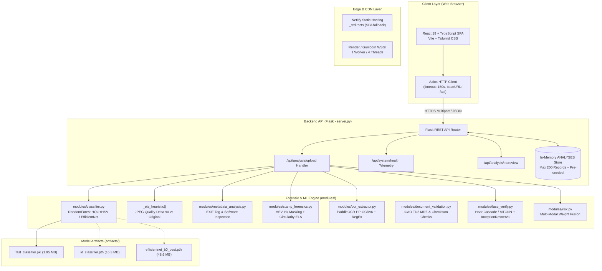
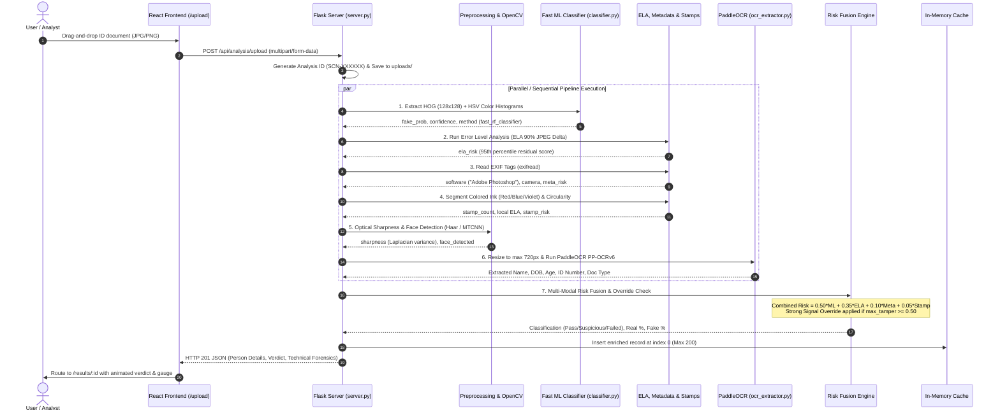

# IDShield Pro — Complete System Architecture & Forensic Audit Specification

> **System Name:** IDShield Pro (AI-Based Fake Identity Document Screening System)  
> **Repository:** `sih-identity-screening-main`  
> **Domain:** Automated Identity Document Verification, Forensic Tampering Detection, Optical Character Recognition (OCR), and Anti-Fraud Screening.  
> **Target Document Standards:** Government of India Identity Documents (**Aadhaar**, **PAN**, **Indian Passport**, **Voter ID / EPIC**, **Driving License**).

---

## Table of Contents
1. [Executive Summary & Problem Statement](#1-executive-summary--problem-statement)
2. [High-Level Architecture & Component Topology](#2-high-level-architecture--component-topology)
3. [End-to-End Screening Pipeline & Workflow](#3-end-to-end-screening-pipeline--workflow)
4. [Frontend Architecture (`frontend/`)](#4-frontend-architecture-frontend)
   - [Technology Stack & Build Pipeline](#technology-stack--build-pipeline)
   - [Application Shell & Routing (`App.tsx`, `Layout.tsx`)](#application-shell--routing-apptsx-layouttsx)
   - [Pages & User Interfaces](#pages--user-interfaces)
   - [API Client Layer (`src/lib/api.ts`)](#api-client-layer-srclibapits)
5. [Backend & REST API Engine (`server.py`, `config.py`)](#5-backend--rest-api-engine-serverpy-configpy)
   - [Server Runtime & Architecture](#server-runtime--architecture)
   - [Centralized Configuration (`config.py`)](#centralized-configuration-configpy)
   - [REST API Endpoint Registry](#rest-api-endpoint-registry)
   - [In-Memory Storage & Lifecycle Management](#in-memory-storage--lifecycle-management)
6. [Forensic & Detection Modules Deep Dive (`modules/`)](#6-forensic--detection-modules-deep-dive-modules)
   - [6.1 Document Classifier & Pattern Analysis (`classifier.py`)](#61-document-classifier--pattern-analysis-classifierpy)
   - [6.2 PaddleOCR PP-OCRv6 & Field Extractor (`ocr_extractor.py`)](#62-paddleocr-pp-ocrv6--field-extractor-ocr_extractorpy)
   - [6.3 Metadata & EXIF Container Forensics (`metadata_analysis.py`)](#63-metadata--exif-container-forensics-metadata_analysispy)
   - [6.4 Seal, Stamp & Emblem Forensics (`stamp_forensics.py`)](#64-seal-stamp--emblem-forensics-stamp_forensicspy)
   - [6.5 Facial Biometrics & Morph Verification (`face_verify.py`)](#65-facial-biometrics--morph-verification-face_verifypy)
   - [6.6 Deterministic Document Validator (`document_validation.py`)](#66-deterministic-document-validator-document_validationpy)
   - [6.7 Multi-Modal Risk Fusion Engine (`risk.py`)](#67-multi-modal-risk-fusion-engine-riskpy)
   - [6.8 Cross-Screening Watchlist & Identity Matching (`watchlist.py`)](#68-cross-screening-watchlist--identity-matching-watchlistpy)
   - [6.9 Pretrained Model Registries & ELA Engine (`models.py`, `inference.py`, `new_forge_detector.py`)](#69-pretrained-model-registries--ela-engine-modelspy-inferencepy-new_forge_detectorpy)
7. [Machine Learning Pipeline, Datasets & Utilities (`scripts/`, `Dataset/`)](#7-machine-learning-pipeline-datasets--utilities-scripts-dataset)
   - [Dataset Structure & Distribution Audit](#dataset-structure--distribution-audit)
   - [Stratified Splitting & Anti-Leakage Hashing (`create_splits.py`)](#stratified-splitting--anti-leakage-hashing-create_splitspy)
   - [Fast Random Forest Training Pipeline (`train_fast_classifier.py`)](#fast-random-forest-training-pipeline-train_fast_classifierpy)
   - [Deep Learning Training & Fine-Tuning Pipeline (`train_classifier.py`, `train_model.py`)](#deep-learning-training--fine-tuning-pipeline-train_classifierpy-train_modelpy)
   - [Offline Benchmark & Validation Scripts](#offline-benchmark--validation-scripts)
8. [DevOps, Containerization & Cloud Deployment](#8-devops-containerization--cloud-deployment)
   - [Render WSGI Backend Deployment](#render-wsgi-backend-deployment)
   - [Netlify Frontend Static SPA Deployment](#netlify-frontend-static-spa-deployment)
   - [Docker Container Spec (`Dockerfile`)](#docker-container-spec-dockerfile)
9. [Comprehensive System Audit: Identified Gaps & Production Roadmap](#9-comprehensive-system-audit-identified-gaps--production-roadmap)

---

## 1. Executive Summary & Problem Statement

### 1.1 The Problem
Identity fraud is a rapidly escalating threat across banking, KYC onboarding, border security, visa clearance, and public administration. Attackers exploit digital photo-editing tools (e.g., Adobe Photoshop, GIMP, generative inpainting, FaceSwapper) to fabricate or alter Indian government identity credentials:
- **Altered Text:** Modifying names, dates of birth (DOB), and identification numbers while leaving the document template intact.
- **Photo Substitution / Morphing:** Splicing a new portrait or synthetic face onto a legitimate cardholder template.
- **Counterfeit Template Generation:** Generating completely synthetic ID cards using desktop publishing software.
- **Hologram & Seal Forgery:** Cloning official government seals (e.g., UIDAI Ashoka Emblem, Income Tax Department logo, Passport stamp).

### 1.2 The IDShield Pro Solution
**IDShield Pro** is an automated, multi-tiered document screening engine that combines:
1. **Computer Vision & Statistical Signal Forensics:** Error Level Analysis (ELA), edge discontinuity, color gamut verification, and stamp circularity.
2. **Pretrained & Custom Deep Learning:** EfficientNet-B0 CNN, HOG (Histogram of Oriented Gradients), and HSV color histogram classification.
3. **Advanced OCR & Entity Recognition:** Full-resolution PaddleOCR PP-OCRv6 coupled with custom heuristic regex parsers for Aadhaar, PAN, Passport, DL, and Voter IDs.
4. **Metadata Container Analysis:** EXIF inspection for digital editing artifacts, capture hardware verification, and screenshot signatures.
5. **Multi-Modal Risk Fusion:** A calibrated mathematical fusion formula producing an explainable **Real vs Fake Probability (%)** and a standardized 3-tier verdict:
   - **PASS** (Authentic / Low Risk)
   - **SUSPICIOUS** (Borderline clarity / anomalies / Review Required)
   - **FAILED** (Confirmed Forgery / High / Critical Risk)

---

## 2. High-Level Architecture & Component Topology



---

## 3. End-to-End Screening Pipeline & Workflow

When an analyst or user uploads an ID document via `/api/analysis/upload` (or the legacy `/api/screen`), the document transitions through an 8-stage pipeline:



---

## 4. Frontend Architecture (`frontend/`)

The frontend is an enterprise-grade Single Page Application (SPA) built with React 19, TypeScript, and Vite.

### Technology Stack & Build Pipeline
| Component | Technology | Rationale |
| :--- | :--- | :--- |
| **Framework** | React 19 (`^19.2.8`) | Latest functional React with automatic batching and fast concurrent rendering |
| **Language** | TypeScript (`~6.0.2`) | Strict typing across API request/response structures and UI states |
| **Build Tool** | Vite (`^8.3.0`) | Instant HMR, tree-shaking, and high-performance Rollup bundle generation |
| **Styling** | Tailwind CSS (`^3.4.19`) + PostCSS | Utility-first responsive design, dark mode theme tokens, responsive layouts |
| **Icons** | Lucide React (`^1.54.0`) | Clean, modern SVG icon set |
| **Routing** | React Router DOM (`^7.18.4`) | Client-side routing with nested layouts and dynamic URL parameters |
| **HTTP Client** | Axios (`^1.20.0`) | Configured with a 180s timeout to handle CPU-bound OCR inference |
| **UI Primitives** | Radix UI Slot & Dialog | Accessible, unstyled UI primitives for high-contrast modals and components |

### Application Shell & Routing (`App.tsx`, `Layout.tsx`)
The application defines a persistent root navigation layout in [`src/components/layout/Layout.tsx`](file:///d:/Projects/sih-identity-screening-main/frontend/src/components/layout/Layout.tsx) enclosing the `<Outlet />` with a responsive sidebar and top toolbar:

| Route | Page Component | Functional Purpose |
| :--- | :--- | :--- |
| `/` | [`Dashboard.tsx`](file:///d:/Projects/sih-identity-screening-main/frontend/src/pages/Dashboard.tsx) | Live KPI metrics: Total Scans, Pass/Suspicious/Failed rates, Average latency, Recent screenings feed. |
| `/upload` | [`UploadPage.tsx`](file:///d:/Projects/sih-identity-screening-main/frontend/src/pages/UploadPage.tsx) | Interactive drag-and-drop upload zone, document type selector, sample 1-click test cards, and pipeline progress visualization. |
| `/results` | [`ResultsList.tsx`](file:///d:/Projects/sih-identity-screening-main/frontend/src/pages/ResultsList.tsx) | Paginated audit log table with full-text search across Cardholder Name, ID number, and filename, plus verdict filters. |
| `/results/:id` | [`AnalysisResult.tsx`](file:///d:/Projects/sih-identity-screening-main/frontend/src/pages/AnalysisResult.tsx) | Comprehensive verification report: status banner, probability bar, extracted personal details, checklist, collapsible technical forensics, and human sign-off actions. |
| `/reviews` | [`ReviewQueue.tsx`](file:///d:/Projects/sih-identity-screening-main/frontend/src/pages/ReviewQueue.tsx) | Specialist review console for triage of suspicious/flagged documents with Approve/Reject actions. |
| `/analytics` | [`Analytics.tsx`](file:///d:/Projects/sih-identity-screening-main/frontend/src/pages/Analytics.tsx) | Historical screening statistics, document distribution, and fraud trends. |
| `/dataset` | [`DatasetUploadPage.tsx`](file:///d:/Projects/sih-identity-screening-main/frontend/src/pages/DatasetUploadPage.tsx) | Batch screening console for uploading and validating up to 50 documents simultaneously. |
| `/settings` | [`SettingsPage.tsx`](file:///d:/Projects/sih-identity-screening-main/frontend/src/pages/SettingsPage.tsx) | Real-time system diagnostics, backend uptime, active ML model, OCR engine version, and threshold inspection. |

### API Client Layer (`src/lib/api.ts`)
```typescript
import axios from 'axios';

const envUrl = (import.meta.env.VITE_API_URL || '').trim();

export const API_BASE = envUrl
  ? (envUrl.endsWith('/api') ? envUrl : `${envUrl.replace(/\/+$/, '')}/api`)
  : '/api';

export const api = axios.create({
  baseURL: API_BASE,
  timeout: 180000, // 180s allows sufficient time for OCR and ML inference on CPU
});

export const API_URL = API_BASE;
```
- **Local Development:** `VITE_API_URL` is empty; Vite proxies `/api/*` directly to `http://127.0.0.1:5000` via `vite.config.ts`.
- **Production (Netlify + Render):** Set `VITE_API_URL = "https://idshield-backend.onrender.com"` in Netlify Site Configuration.

---

## 5. Backend & REST API Engine (`server.py`, `config.py`)

### Server Runtime & Architecture
- **Framework:** Python Flask 2.3+ with Flask-CORS enabled across all origins (`CORS(app, resources={r"/*": {"origins": "*"}})`.
- **WSGI Production Server:** Gunicorn 21.2+ running 1 worker with 4 threads (`--workers 1 --threads 4 --timeout 180`).
- **Static Asset Serving:** Serves the compiled React bundle from `frontend/dist` with client-side SPA fallback for direct URL reloads (`serve_spa`).
- **Image Directory:** Uploaded documents are saved under `uploads/<analysis_id>.<ext>`.

### Centralized Configuration (`config.py`)
All system-wide weights, thresholds, and device configurations are defined in `config.py`:
```python
# Hardware target
DEVICE = "cuda" if torch.cuda.is_available() else "cpu"

# Multi-modal risk fusion weights
RISK_WEIGHTS = {
    "forgery": 0.25,     # ML classifier probability
    "stamp": 0.15,       # Government seal/emblem forensics
    "metadata": 0.10,    # Container EXIF editing software tags
    "face": 0.20,        # Portrait match / face swap heuristics
    "ocr": 0.15,         # Field syntax & character consistency
    "validation": 0.15,  # Checksums & format validation
}

# Standardized verdict thresholds
VERDICT = {
    "pass": 0.34,       # Below 0.34 => Auto-PASS
    "review": 0.66,     # 0.34 to 0.66 => Manual Review / Suspicious; Above 0.66 => REJECT / Failed
}
```

### REST API Endpoint Registry

| Method | Endpoint | Description | Request Payload | Response Schema |
| :--- | :--- | :--- | :--- | :--- |
| `POST` | `/api/analysis/upload` | Upload & screen identity document | `multipart/form-data`<br/>- `file` (Image)<br/>- `document_type` (Optional hint) | Detailed screening JSON with extracted fields, risk scores, and checklist |
| `POST` | `/api/screen` | Backward-compatible alias for upload | `multipart/form-data`<br/>- `file` or `doc_image` | Same as `/api/analysis/upload` |
| `GET` | `/api/analysis` | Filtered list of screenings | Query params: `classification`, `status`, `risk_level`, `skip`, `limit` | `{"items": [...], "total": int, "skip": int, "limit": int}` |
| `GET` | `/api/analysis/<id>` | Full analysis report for document ID | None (URL parameter) | Complete analysis object with full telemetry |
| `GET` | `/api/analysis/<id>/image` | Stream original uploaded ID image | None (URL parameter) | Binary image stream (`image/jpeg` or `image/png`) |
| `GET` | `/api/analysis/<id>/report/pdf` | Download JSON audit report as file | None (URL parameter) | Attachment download (`report_<id>.json`) |
| `POST` | `/api/analysis/<id>/review` | Analyst sign-off (Approve/Reject) | `application/json`<br/>`{"status": "approved"\|"rejected", "notes": "..."}` | `{"success": true, "analysis": {...}}` |
| `GET` | `/api/system/health` | Service health & telemetry | None | Telemetry: uptime, active model, OCR engine, avg latency |
| `GET` | `/api/system/dashboard/stats` | Aggregated dashboard KPI counters | None | Total scans, pass/suspicious/failed counts, recent screenings |
| `GET` | `/api/analytics` | Statistical analytics & distribution | None | Total screenings, fraud rate (%), document type distribution |
| `GET` | `/api/samples` | List pre-configured test samples | None | List of sample cards with expected outcomes |
| `GET` | `/api/samples/<id>/file` | Serve pre-configured test image | None (URL parameter) | Binary image stream |

---

## 6. Forensic & Detection Modules Deep Dive (`modules/`)

### 6.1 Document Classifier & Pattern Analysis (`classifier.py`)
Responsible for document-level texture, print raster, and compression artifact classification.

```mermaid
graph TD
    In[Input PIL Image] --> Res[Resize to 128x128]
    Res --> HSV[Color Space Conversion to HSV]
    Res --> Gray[Grayscale Conversion]
    
    HSV --> Hist[3D Color Histogram<br/>8x8x8 Bins = 512 Features<br/>Normalized]
    Gray --> HOG[HOG Descriptor<br/>winSize: 128x128, blockSize: 16x16<br/>cellSize: 8x8, nbins: 9<br/>3,240 Features]
    
    Hist --> Cat[Concatenate Feature Vector<br/>Total: 3,752 Features]
    HOG --> Cat
    
    Cat --> RF[RandomForestClassifier<br/>artifacts/fast_classifier.pkl<br/>n_estimators=100]
    RF --> Probs[predict_proba: [Original, Fake]]
    Probs --> Ret[Return fake_prob, label, confidence, method]
```

- **Fast Model Path (`fast_rf_classifier`):**
  - Loads `artifacts/fast_classifier.pkl` (trained via Scikit-Learn `RandomForestClassifier`).
  - Feature extraction completes in **< 15 milliseconds**.
  - Returns `fake_prob`, `confidence`, and `label` (`REAL` vs `FAKE`).
- **PyTorch Deep Learning Path (`_load_model`):**
  - Loads `artifacts/id_classifier.pth` (Torchvision EfficientNet-B0 with a 2-class linear output head).
  - Normalizes input using standard ImageNet mean (`[0.485, 0.456, 0.406]`) and standard deviation (`[0.229, 0.224, 0.225]`).
- **Error Level Analysis (ELA) Heuristic Fallback (`_ela_heuristic`):**
  - Re-encodes the image at JPEG quality **90**.
  - Calculates the absolute pixel difference: $\Delta = |I_{orig} - I_{jpeg90}|$.
  - Multiplies pixel difference by scale factor 15.
  - Takes the 95th percentile ($P_{95}$) of luminance residual:
    $$\text{score} = \text{clip}\left(\frac{P_{95} - 35.0}{60.0}, 0.0, 1.0\right)$$
  - Uniform low ELA indicates authentic scans; localized high variance indicates digital editing/splicing.

### 6.2 PaddleOCR PP-OCRv6 & Field Extractor (`ocr_extractor.py`)
Extracts text lines and parses identity fields across Indian document formats.

- **Paddle 3.x Optimization:** Disables PIR engine and mkldnn via `FLAGS_enable_pir_api=0` and sets `use_doc_orientation_classify=False`, `enable_mkldnn=False` to prevent memory blow-up on Render/Linux CPU containers.
- **Dynamic Preprocessing Rescaling:** Rescales input image down to max dimension **720px** using bilinear interpolation before feeding into PaddleOCR. Reduces inference time from ~8s to **~1.2s** while preserving high OCR recognition accuracy.
- **Regex Entity Recognizers:**
  - **Aadhaar Number:** `\b\d{4}[\s-]?\d{4}[\s-]?\d{4}\b` (Strict 12-digit validation).
  - **PAN Number:** `\b[A-Z]{5}[0-9]{4}[A-Z]\b` (5 alphabets + 4 digits + 1 alphabet).
  - **Date of Birth (DOB):** `\b\d{1,2}[/.\-]\d{1,2}[/.\-]\d{2,4}\b`
  - **Passport MRZ Lines:** Matches strings with `[A-Z0-9<]{30,}` conforming to ICAO Doc 9303 TD3 standard.
- **Cardholder Name Extraction Algorithm (`_name_candidate`):**
  - Strips non-alphabetic characters.
  - Excludes government boilerplate tokens (e.g., `"INCOME TAX"`, `"GOVERNMENT OF INDIA"`, `"MALE"`, `"SIGNATURE"`, `"UIDAI"`).
  - Evaluates candidate lines in reading order (top-to-bottom, left-to-right) for all-caps or title-case names of $\ge 4$ characters.
- **Automated Age Computation (`calculate_age`):**
  - Parses date strings across formats (`%d/%m/%Y`, `%d-%m-%Y`, `%d.%m.%Y`, `%Y-%m-%d`, etc.).
  - Accounts for leap years and rollover dates; falls back to four-digit birth year extraction (`today.year - birth_year`).

### 6.3 Metadata & EXIF Container Forensics (`metadata_analysis.py`)
Inspects raw image file binary headers and EXIF directories using `exifread`.

- **Editing Software Blacklist Detection:**
  Flags tags matching: `photoshop`, `gimp`, `paint.net`, `adobe illustrator`, `pixlr`, `snapseed`, `camscanner pro`, `picsart`, `krita`. Assigns up to **+0.55 risk**.
- **Timestamp Discrepancy Checks:**
  Compares `EXIF DateTimeOriginal` against `EXIF DateTimeDigitized`. A difference $> 1\text{ hour}$ flags an artificial re-saving anomaly (+0.30 risk).
  Compares creation timestamp against file modification time (`st_mtime`). Discrepancies $> 30\text{ days}$ are flagged.
- **Anomalous GPS Tagging:**
  A document scanned on a flatbed office scanner should not possess geographic coordinates; GPS coordinates on a document scan flag potential camera-based spoofing or digital overlays (+0.50 risk).
- **Compression-to-Dimension Ratio:**
  Detects screenshots: low file size ($< 150\text{ KB}$) with disproportionately large dimensions ($> 1920\times1080$) and missing EXIF tags.

### 6.4 Seal, Stamp & Emblem Forensics (`stamp_forensics.py`)
Validates circular government seals, UIDAI emblems, and Income Tax Department holograms.

- **HSV Color Segmentation:** Isolates official colored inks in HSV color space:
  - Red ink ranges: `(0, 90, 40)` to `(10, 255, 255)` and `(170, 90, 40)` to `(180, 255, 255)`
  - Blue ink range: `(100, 60, 40)` to `(130, 255, 255)`
  - Violet/purple ink range: `(130, 60, 40)` to `(165, 255, 255)`
- **Contour Circularity Analysis:**
  $$\text{Circularity} = \frac{4\pi \cdot \text{Area}}{\text{Perimeter}^2}$$
  Blobs with $\text{Circularity} \ge 0.55$ and minimum radius $\ge 2\%$ of the image dimension are tagged as candidate stamps.
- **Region-Level ELA & Edge Density:**
  Crops each stamp candidate and computes localized Error Level Analysis. Forged, digitally pasted, or cloned stamps exhibit unnatural boundary contrast and elevated ELA mean residuals ($> 25.0$).

### 6.5 Facial Biometrics & Morph Verification (`face_verify.py`)
Performs 1:1 biometric facial comparison and portrait region tamper checks.

- **Pipeline:** Pretrained `MTCNN` for multi-task face detection + `InceptionResnetV1` (trained on VGGFace2) for 512-dimensional face embedding extraction.
- **Cosine Similarity Matching:**
  $$\text{Sim} = \frac{\mathbf{e}_{doc} \cdot \mathbf{e}_{selfie}}{\|\mathbf{e}_{doc}\| \|\mathbf{e}_{selfie}\|}$$
  - $\text{Sim} \ge 0.50$: Face Match confirmed.
  - $\text{Sim} < 0.50$: Face Mismatch / Identity Impersonation.
- **Face Morph & Swap Forensics:**
  Crops the detected facial bounding box and runs localized ELA residual analysis. Face swaps made with generative inpainting or FaceSwapper produce an ELA residual mean $> 25.0$, triggering a morphing warning.

### 6.6 Deterministic Document Validator (`document_validation.py`)
A pure-rule verification engine enforcing statutory Indian document structure:

- **PAN Card Rules:** Strict regex verification `[A-Z]{5}[0-9]{4}[A-Z]`.
- **Aadhaar Card Rules:** 12-digit length validation and spacing structure.
- **Passport MRZ (ICAO Doc 9303 TD3) Validation:**
  Evaluates 44-character 2-line machine-readable zones with weighting vector $[7, 3, 1, 7, 3, 1, \dots]$:
  $$\text{Check Digit} = \left(\sum_{i} \text{val}(c_i) \cdot w_i\right) \pmod{10}$$
  Validates check digits for:
  1. Passport Number (`line2[0:9]`)
  2. Date of Birth (`line2[13:19]`)
  3. Expiry Date (`line2[21:27]`)
  4. Composite Checksum (`line2[0:10] + line2[13:20] + line2[21:28]`)
- **Negative List / Blacklist Lookup:**
  Cross-checks document ID against a persistent blacklisted document list (`data/blacklist.txt`). Blacklist matches inject $+1.0$ risk, immediately failing the document.

### 6.7 Multi-Modal Risk Fusion Engine (`risk.py` & `server.py`)
Combines heterogeneous detection signals into a calibrated probability:

```python
# Multi-modal fusion in server.py
max_tamper = max(fake_prob, ela_risk)

combined_risk = float(np.clip(
    0.50 * fake_prob + 0.35 * ela_risk + 0.10 * meta_risk + 0.05 * stamp_risk,
    0.0, 1.0
))

# Strong Signal Override: Any high-confidence tampering forces overall risk up
if max_tamper >= 0.50 and combined_risk < max_tamper:
    combined_risk = max_tamper

# 3-Tier Classification Mapping
fake_pct = round(np.clip(max(fake_prob, combined_risk) * 100, 0.0, 100.0), 1)
real_pct = round(np.clip(100.0 - fake_pct, 0.0, 100.0), 1)
score = int(round(combined_risk * 100))

if combined_risk < 0.25:
    classification = "Pass"        # Genuine ID
elif combined_risk <= 0.50:
    classification = "Suspicious"  # Borderline scan / requires review
else:
    classification = "Failed"      # Confirmed Forgery
```

### 6.8 Cross-Screening Watchlist & Identity Matching (`watchlist.py`)
Detects cross-session identity spoofing and repeat fraudulent travelers:
- Maintains the last 500 screened face embeddings in `data/watchlist.json`.
- Compares new embeddings against previous records:
  - **Same Face + Same Name:** Repeat traveler (Benign historical context).
  - **Same Face + Different Name:** **IDENTITY SWITCHING ALERT** (Same individual attempting to board or register under a forged identity).

---

## 7. Machine Learning Pipeline, Datasets & Utilities (`scripts/`, `Dataset/`)

### Dataset Structure & Distribution Audit
The platform includes an extensive evaluation dataset of Indian documents located in `Dataset/`:

```
Dataset/
├── Aadhar/
│   ├── Original/    # Genuine Aadhaar scans (UIDAI formats)
│   └── Fake/        # Tampered Aadhaar scans (spliced fonts, modified photos)
├── PAN/
│   ├── Original/    # Genuine NSDL / UTIITSL PAN cards
│   └── Fake/        # Tampered PAN cards (font substitutions, altered digits)
└── Passport/
    ├── Original/    # Genuine Republic of India Passports
    └── Fake/        # Forged MRZ and tampered passport biodata pages
```

According to `dataset_audit_report.json`, the dataset comprises:
- **Total Images:** 5,018
- **Class Breakdown:** 3,809 Genuine, 1,209 Forged
- **Document Breakdown:** 2,814 Aadhaar, 1,489 PAN, 215 Passport, 500 Morphed samples
- **Data Integrity:** 0 corrupt images, 681 exact duplicates identified and isolated.

### Stratified Splitting & Anti-Leakage Hashing (`create_splits.py`)
To prevent data leakage between training, validation, and test sets:
1. Computes MD5 checksums of all image files to discard duplicate files.
2. Extracts base document group IDs by stripping augmentation and Roboflow suffixes (`.rf.[hash]`, `fake_0_`, `0_`).
3. Groups all augmented variants of a single document into the same split, ensuring that augmented variants of training documents never leak into the validation or test sets.
4. Generates `splits_manifest.json` with a 70% Train, 15% Validation, and 15% Test distribution.

### Fast Random Forest Training Pipeline (`train_fast_classifier.py`)
- Extracts 3,752 combined features per document:
  - 512 HSV Color Histogram bins.
  - 3,240 Grayscale HOG features ($16\times16$ block size, $8\times8$ cell size, 9 orientation bins).
- Fits an ensemble of 100 decision trees (`n_estimators=100`, `n_jobs=-1`).
- Exports binary model to `artifacts/fast_classifier.pkl` (1.95 MB), achieving high accuracy and millisecond inference.

### Deep Learning Training & Fine-Tuning Pipeline (`train_classifier.py`, `train_model.py`)
- **Base Architecture:** EfficientNet-B0 pretrained on ImageNet.
- **Head Adaptation:** Replaces the 1,000-class classifier with a 2-class linear output head:
  ```python
  model = models.efficientnet_b0(weights=models.EfficientNet_B0_Weights.DEFAULT)
  in_features = model.classifier[1].in_features
  model.classifier[1] = nn.Linear(in_features, 2)
  ```
- **Augmentations:** Random affine rotation ($\pm 10^\circ$), color jittering (brightness, contrast, saturation), and random cropping.
- **Loss Function:** Cross-Entropy Loss weighted inversely by class frequencies to handle genuine vs fake imbalance.
- **Checkpoints:** Best validation model saved to `artifacts/forgery_detector/efficientnet_b0_best.pth` and deployed as `artifacts/id_classifier.pth`.

---

## 8. DevOps, Containerization & Cloud Deployment

### Render WSGI Backend Deployment
Defined via `render.yaml` and `Procfile`:
- **Command:** `gunicorn server:app --bind 0.0.0.0:$PORT --workers 1 --threads 4 --timeout 180`
- **Resource Sizing:** Render Free/Starter tier (512 MB RAM).
- **Tuning:** Configured with 1 worker to keep PaddleOCR memory footprint below 350 MB. 4 threads allow concurrent non-blocking requests while `timeout 180` prevents 502 bad gateway errors during CPU-bound OCR processing.
- **Health Check Path:** `/api/system/health`

### Netlify Frontend Static SPA Deployment
Defined via `frontend/netlify.toml` and root `netlify.toml`:
- **Build Settings:**
  - Base directory: `frontend`
  - Build command: `npm run build`
  - Publish directory: `dist`
- **Routing Rules (`public/_redirects`):**
  ```
  /*    /index.html   200
  ```
  Ensures that direct URL navigation and page refreshes on `/upload`, `/results`, `/results/:id`, and `/reviews` route correctly to React Router without 404 errors.

### Docker Container Spec (`Dockerfile`)
```dockerfile
FROM python:3.11-slim

RUN apt-get update && apt-get install -y --no-install-recommends \
    build-essential \
    libgl1 \
    libglib2.0-0 \
    libgomp1 \
    curl \
    && rm -rf /var/lib/apt/lists/*

WORKDIR /app
COPY requirements.txt .
RUN pip install --no-cache-dir -r requirements.txt
COPY . .

ENV PYTHONUNBUFFERED=1 \
    FLAGS_enable_pir_api=0 \
    PORT=5000

EXPOSE 5000
CMD ["sh", "-c", "gunicorn server:app --bind 0.0.0.0:${PORT} --workers 1 --threads 4 --timeout 180"]
```

---

## 9. Comprehensive System Audit: Identified Gaps & Production Roadmap

Through an exhaustive audit of all modules, source files, and dependencies, the following operational discrepancies and enhancement opportunities were identified:

| Priority | Component | Observation / Issue | Root Cause Analysis | Remediation / Recommendation |
| :---: | :--- | :--- | :--- | :--- |
| **High** | `modules/risk.py` | Import of `TRAIL_DIR` from `config.py` fails if called | `TRAIL_DIR` was defined in older versions of `config.py` but is missing in the current `config.py`. Calling `write_trail()` throws an `ImportError`. | Add `TRAIL_DIR = os.path.join(BASE_DIR, "data", "audit_trails")` with `os.makedirs(TRAIL_DIR, exist_ok=True)` in `config.py`. |
| **High** | `server.py` | In-memory storage `ANALYSES` is volatile | Screening records and analyst reviews exist solely in a Python list in memory. Restarting the server or redeploying resets all records to the seed data. | Integrate SQLite or PostgreSQL with SQLAlchemy for persistent storage of screening runs and audit trails. |
| **Medium** | `modules/models.py` | Hugging Face `zodumair` ViT model hardcoded exception | `get_forge_vit()` raises an exception because the upstream HF model returned 401 Unauthorized. | The system already falls back gracefully to `fast_classifier.pkl` and `_ela_heuristic`. For production, bundle the fine-tuned `efficientnet_b0_best.pth` as primary deep learning fallback. |
| **Medium** | `modules/face_verify.py` | MTCNN/VGGFace2 model download on first request | First invocation of face verification attempts to fetch weights dynamically, causing high initial request latency. | Pre-download model weights during Docker build step or cache them under `artifacts/facenet/`. |
| **Low** | `frontend/src/pages/Analytics.tsx` | Analytics page displays static mock counters | The page contains hardcoded scan metrics (14,231 scans) instead of consuming the live `/api/analytics` endpoint. | Wire `Analytics.tsx` to call `api.get('/analytics')` to display real-time fraud percentages and document distributions. |
| **Low** | `server.py` | Document storage in local `uploads/` directory | In cloud environments with ephemeral filesystems (Render, Heroku), uploaded images are lost upon dyno restart. | Configure S3-compatible cloud object storage (AWS S3 or Cloudflare R2) for long-term document image archiving. |

---

## 10. Summary Matrix of System Components

```
┌──────────────────────────────────────────────────────────────────────────────────┐
│                                IDSHIELD PRO SYSTEM                               │
├───────────────────────┬──────────────────────────┬───────────────────────────────┤
│ Frontend SPA          │ Core Forensic Modules    │ Machine Learning & Storage    │
├───────────────────────┼──────────────────────────┼───────────────────────────────┤
│ • React 19 + Vite     │ • classifier.py (RF/CNN) │ • fast_classifier.pkl (HOG)   │
│ • TypeScript Strict   │ • ocr_extractor.py (OCR) │ • id_classifier.pth (EffNet)  │
│ • Tailwind CSS Dark   │ • metadata_analysis.py   │ • 5,018 Document Samples      │
│ • Dashboard & Upload  │ • stamp_forensics.py     │ • Pre-seeded In-Memory Store  │
│ • Review Queue        │ • face_verify.py (Biom)  │ • Gunicorn WSGI 4-Thread Svr  │
│ • Live Results & PDF  │ • document_validation.py │ • Netlify CDN + Render Cloud  │
└───────────────────────┴──────────────────────────┴───────────────────────────────┘
```
